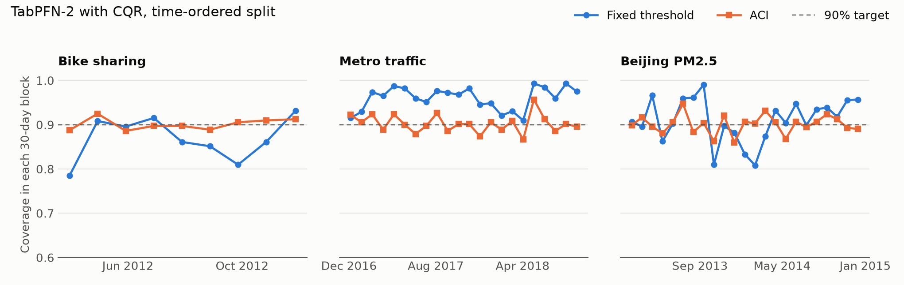

# Temporal Conformal Tabular

Does a 90% conformal prediction interval stay valid as time passes, and can recalibration restore it? This project tests TabPFN-2 and gradient boosting on three public time-stamped datasets.

Built with PriorLabs-TabPFN.

## Main findings

- **Random splits hide the problem.** With a random split, every model and score stayed close to the target (0.893 to 0.909).
- **A fixed threshold can drift in either direction.** With a time-ordered split, coverage was too low on Bike sharing (0.828 to 0.876) and too high on Metro traffic (0.942 to 0.961). On Beijing PM2.5 it looked fine on average (0.909 to 0.921), but dropped as low as 0.683 in a single 30-day block.
- **Recalibration restored average coverage.** Weekly rolling recalibration reached 0.893 to 0.913, and adaptive conformal inference (ACI) reached 0.900 to 0.905.
- **ACI gave the steadiest coverage over time.** Its lowest 30-day coverage was 0.838 to 0.886, compared with 0.683 to 0.910 for the fixed threshold and 0.689 to 0.840 for rolling.
- **TabPFN's raw bands were good only without a time shift.** Its 5% to 95% band covered 0.877 to 0.901 under random splits, but only 0.278 on time-ordered Bike sharing.



## Method

| Part | Choice |
|---|---|
| **Data** | [Bike sharing](https://archive.ics.uci.edu/dataset/275/bike+sharing+dataset), [Metro traffic](https://archive.ics.uci.edu/dataset/492/metro+interstate+traffic+volume) and [Beijing PM2.5](https://archive.ics.uci.edu/dataset/381/beijing+pm2+5+data) from the UCI repository |
| **Models** | [TabPFN-2](https://huggingface.co/Prior-Labs/TabPFN-v2-reg) with 4 ensemble members, and scikit-learn `HistGradientBoostingRegressor` (GBDT) with fixed settings |
| **Predictions** | The 5%, 50% and 95% quantiles |
| **Splits** | 50% training (at most 5,000 rows, the same for both models), 10% calibration and 40% test, split either at random or in time order |
| **Interval scores** | Absolute residual around the median, and conformalized quantile regression (CQR) |
| **Fixed** | One threshold from the calibration block |
| **Rolling** | Every 168 rows, one week of hourly data, the threshold is recomputed from the latest scores. The window is the size of the calibration block. |
| **ACI** | The miscoverage level is updated after each row, with step size 0.005 |

Date and year columns are not model inputs, but month, hour and weekday are. Interval width is divided by the interquartile range of the target in the dataset's time-ordered calibration block, so widths are comparable within a dataset.

## Results

Coverage has a 0.90 target. "Worst" is the lowest coverage in a 30-day block (720 rows). "Width" is the scaled mean interval width.

### Bike sharing

| Model | Score | Random, fixed | Time, fixed | Time, rolling | Time, ACI |
|---|---|---:|---:|---:|---:|
| GBDT | Absolute | 0.909 | 0.828 | 0.902 | 0.903 |
| GBDT | CQR | 0.893 | 0.831 | 0.903 | 0.903 |
| TabPFN-2 | Absolute | 0.902 | 0.843 | 0.903 | 0.904 |
| TabPFN-2 | CQR | 0.905 | 0.876 | 0.907 | 0.905 |

### Metro traffic

| Model | Score | Random, fixed | Time, fixed | Time, rolling | Time, ACI |
|---|---|---:|---:|---:|---:|
| GBDT | Absolute | 0.905 | 0.942 | 0.909 | 0.903 |
| GBDT | CQR | 0.903 | 0.954 | 0.911 | 0.901 |
| TabPFN-2 | Absolute | 0.907 | 0.942 | 0.908 | 0.903 |
| TabPFN-2 | CQR | 0.905 | 0.961 | 0.913 | 0.903 |

### Beijing PM2.5

| Model | Score | Random, fixed | Time, fixed | Time, rolling | Time, ACI |
|---|---|---:|---:|---:|---:|
| GBDT | Absolute | 0.901 | 0.909 | 0.893 | 0.900 |
| GBDT | CQR | 0.903 | 0.921 | 0.903 | 0.900 |
| TabPFN-2 | Absolute | 0.900 | 0.912 | 0.896 | 0.900 |
| TabPFN-2 | CQR | 0.901 | 0.911 | 0.905 | 0.901 |

### Width and worst block, time-ordered split with CQR

| Dataset | Model | Fixed: worst, width | Rolling: worst, width | ACI: worst, width |
|---|---|---:|---:|---:|
| Bike sharing | GBDT | 0.740, 2.05 | 0.807, 2.56 | 0.883, 2.52 |
| Bike sharing | TabPFN-2 | 0.785, 1.92 | 0.822, 2.19 | 0.886, 2.12 |
| Metro traffic | GBDT | 0.910, 0.51 | 0.840, 0.44 | 0.867, 0.43 |
| Metro traffic | TabPFN-2 | 0.910, 0.42 | 0.825, 0.32 | 0.867, 0.31 |
| Beijing PM2.5 | GBDT | 0.812, 1.62 | 0.754, 1.60 | 0.853, 1.62 |
| Beijing PM2.5 | TabPFN-2 | 0.808, 1.52 | 0.787, 1.53 | 0.860, 1.58 |

Recalibration is not always a cost. On Bike sharing it widened the intervals to restore coverage. On Metro traffic it narrowed them, because the fixed threshold was too cautious.

### Raw model bands and error, before conformal adjustment

The band is the raw 5% to 95% quantile range. MAE is scaled the same way as width.

| Dataset | Model | Random: band, MAE | Time: band, MAE |
|---|---|---:|---:|
| Bike sharing | GBDT | 0.815, 0.250 | 0.368, 0.510 |
| Bike sharing | TabPFN-2 | 0.901, 0.230 | 0.278, 0.502 |
| Metro traffic | GBDT | 0.822, 0.075 | 0.817, 0.073 |
| Metro traffic | TabPFN-2 | 0.877, 0.073 | 0.849, 0.072 |
| Beijing PM2.5 | GBDT | 0.803, 0.360 | 0.764, 0.411 |
| Beijing PM2.5 | TabPFN-2 | 0.901, 0.336 | 0.850, 0.397 |

Bike sharing has the strongest shift: mean demand rose from 151 in the calibration block to 256 in the test period, while the models' median prediction averaged about 167 in that period. `results/summary.json` has every result, including 95% block bootstrap intervals for coverage.

## Limitations

- This uses three datasets and one split for each, so it does not show how often each pattern occurs in general.
- The random split places neighboring hours in both training and test data, which makes it an easier setting than a real deployment.
- ACI uses each true value immediately, and rolling uses them at each weekly refresh. Real labels may arrive later, which would reduce both benefits.
- Models are never retrained during the test period, so only the threshold adapts.
- Training is capped at 5,000 rows for both models, and GBDT is not tuned, so this is not a fair ranking of the two models.
- This uses TabPFN-2, not the latest TabPFN release.
- Why the fixed threshold over-covers on Metro traffic has not been investigated.

## Reproduce

The predictions are included, so the analysis needs no GPU:

```bash
pip install -r requirements.txt
python src/analyze.py
python src/plot.py
pytest tests
```

To regenerate the predictions, open `colab_predict.ipynb` in Google Colab, choose a T4 GPU and run all cells. Then copy the output files into `results/predictions/`.

## Files

| Path | Purpose |
|---|---|
| `colab_predict.ipynb` | Loads the data, trains the models and saves quantile predictions |
| `src/conformal.py` | Scores, thresholds, rolling recalibration, ACI and metrics |
| `src/analyze.py` | Produces the results above |
| `src/plot.py` | Produces the figure |
| `tests/test_conformal.py` | Tests on synthetic data, including checks that methods do not look ahead |
| `results/` | Predictions, result summary and figure |

## References

- Romano, Patterson and Candes (2019), [Conformalized Quantile Regression](https://arxiv.org/abs/1905.03222)
- Gibbs and Candes (2021), [Adaptive Conformal Inference Under Distribution Shift](https://arxiv.org/abs/2106.00170)
- Hollmann et al. (2025), [Accurate predictions on small data with a tabular foundation model](https://www.nature.com/articles/s41586-024-08328-6)
